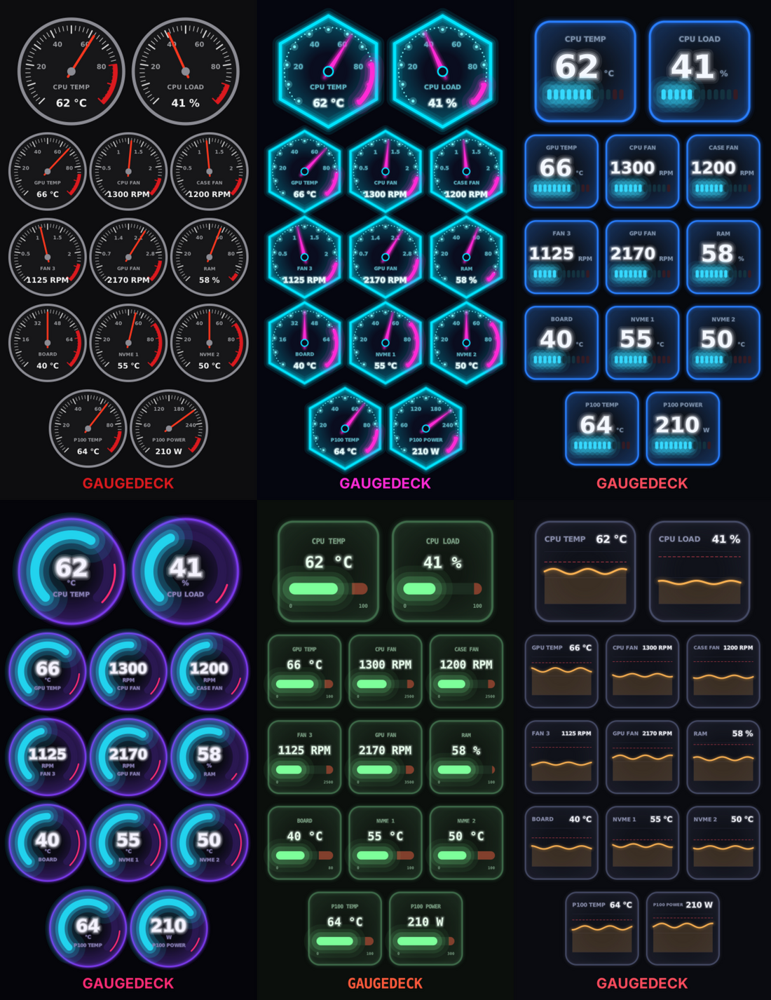

# GaugeDeck

https://github.com/Cyoulater/gaugedeck

Car-style dashboard gauges for your Linux PC: CPU, GPU, fans, drives, RAM, board and any
other sensor it finds. Restyle them (colors, glow, shapes, your own pictures), pop each one into
its own window, pin them to the dock, or keep a slim strip of readings in view.

Built as a native GTK 4 / Wayland app, so it works on current GNOME desktops
(Ubuntu 25.10 / 26.04 and later) where desktop widgets like Conky freeze or
fail to draw.

## Install
    sh install.sh                # or: sh install.sh "MY RIG NAME"   (sets the title shown under the gauges)
Then open **GaugeDeck** from your app menu. Right-click it in the dock
and choose "Pin to Dash" to keep it there. Close it with the X.

## Using it
- **Right-click a gauge** to pop it out into its own window, change just that gauge, or pin it to
  the dock. Each popped-out gauge is its own program with its own dock icon and a live number
  on the icon (on Ubuntu's dock).
- **Menu button (top right)**: Customize look, Choose sensors, open the compact strip, bring all
  gauges back, pin GaugeDeck to the dock.
- **Gauges in their own windows** can hide their title bar (drag them anywhere), be made bigger or
  smaller, and remember that on the next start. "Keep in front..." explains how to make a window
  stay on top.
- **The strip** is a slim row (or column) of readings. Right-click it to choose which gauges it
  shows. Pin it to the dock too.

### Keeping a window in view
On GNOME and Wayland an app can't make its own window stay above the others. GNOME does it for you:
right-click the window's title bar and choose **Always on Top**. Also, the dock number badge
(Ubuntu's dock) shows a pinned gauge's reading even when every window is covered.

## Customize

*Classic, Neon, Dashboard, Ring Lights, Bar Stack and Graph Wall, drawn by GaugeDeck itself with sample
readings (`gaugedeck --demo` shows the same thing live).*

Open the menu, then **Customize look...** Everything changes live, for all gauges or just one.
- **Colors**: background, dial face, rim, ticks, needle, red zone, reading, labels.
- **Gauge style**: Dial, Ring, Bar, Digital (lights up in segments) or Graph (the last 90 readings).
- **Shapes**: round, rounded square, hexagon or octagon; needle (line, arrow, blade); tick marks;
  center cap; sweep; lettering; rim thickness; numbers; red zone.
- **Glow**: one slider for a soft light around the rim, needle, numbers and a backlit face.
- **Pictures**: a picture inside the dial and a picture behind everything, each with a "darken"
  slider so the numbers stay readable. All gauges keep working on top of the picture.
- **Ready-made looks**: Classic, Neon, Ice, Amber, Paper, Terminal, Dashboard, Ring Lights,
  Bar Stack, Graph Wall.

Your look is saved in `~/.config/gaugedeck/theme.json` and every open GaugeDeck window follows it.

## Sensors
GaugeDeck scans the computer at startup and names what it finds: processors (Intel and AMD, with the
model name), graphics cards (AMD, Intel, NVIDIA, named from the system's PCI list or `nvidia-smi`),
NVMe and SATA drives (with their model names), every fan, motherboard temperatures and voltages,
power draw, clocks, memory, swap and disk space.

The usual gauges are shown at first (CPU, GPU, fans, RAM, board, drives, and any NVIDIA card).
Open **Choose sensors...** to switch any other sensor on, and **Scale** to change a sensor's top
value or where its red zone starts. The choice is saved in `~/.config/gaugedeck/sensors.json`.

See everything that was found, with its reading and where it comes from:

    gaugedeck --sensors

If a sensor you expect is missing, send that list in a bug report.
For board sensors, run `sudo sensors-detect` once (package `lm-sensors`).

## Settings
Edit `~/.config/gaugedeck/config` (the title and window size can also be changed in Customize):

    title=MY RIG
    scale=0.6      # 0.3 = tiny, 1.0 = large
    dock_badge=on  # show a live number on the dock icon

## Alerts
GaugeDeck warns you when something is wrong: a desktop notification, an alarm
sound, and the gauge flashes red. It alerts once when a reading stays in the
red for 5 seconds (quick spikes are ignored), and again when it's back to normal.
Every temperature gauge alerts (CPU, GPU, drives, board...), so does memory use.

It also warns if any fan that was spinning stops (0 RPM).

Test it:  `gaugedeck --test-alert` (pop-up, alarm, and the CPU TEMP gauge flashes for 10 seconds)

Each window raises alerts for the gauges it shows, so alerts run while a window is open
(minimize it instead of closing it). The strip stays quiet when the deck or a gauge window already
covers a gauge. A temperature gauge's red zone starts where its alert goes off. Change the limits
in `~/.config/gaugedeck/config`, or per sensor with **Scale**:

    alerts=on
    alert_sound=on
    alert_seconds=5
    cpu_temp_alert=80
    gpu_temp_alert=85
    board_temp_alert=60
    ram_alert=95
    fan_stop_alert=on
    nv_temp_alert=85

## Try it without sensors
    gaugedeck --demo
shows made-up readings, so you can play with looks and windows on any computer. Pinning is off in demo mode.

## What GaugeDeck writes
Sensors are only read (from /sys, /proc and `nvidia-smi`). GaugeDeck writes only:
- `~/.config/gaugedeck/` (settings, look, sensor choice, window layout)
- when you pin a gauge: a launcher and icon in `~/.local/share/applications` and
  `~/.local/share/icons`, and an entry in the dock's favorites (the same as right-click, Add to Favorites)

## Requirements
GTK 4.10 or newer (Ubuntu 24.04 and later), Python 3 with `python3-gi` and `python3-gi-cairo`.

## Tests
    python3 -m unittest discover -s tests -v

## Uninstall
    sh uninstall.sh

## License
GPL-3.0-or-later. Free to use, share, and modify. If you share a changed
version, you must share its source code under the same license. See LICENSE.
